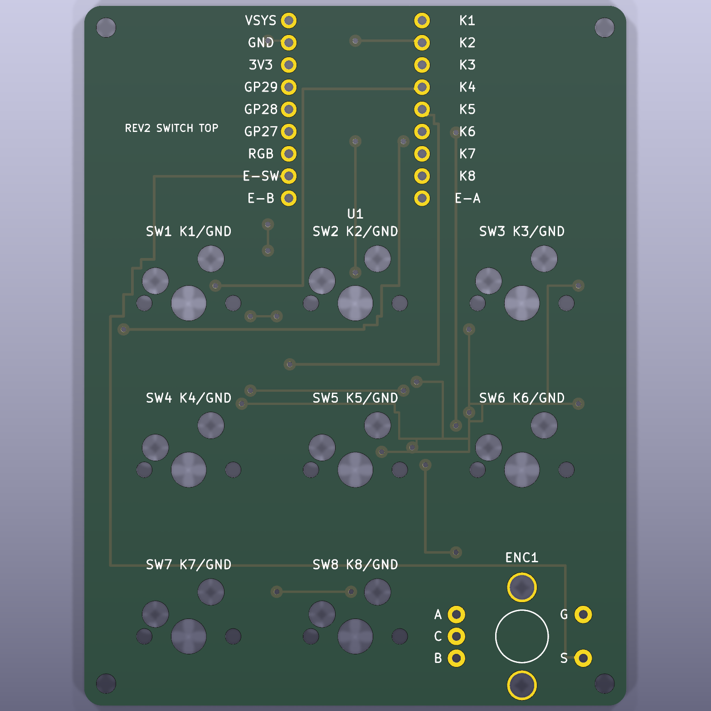

# AgentPad

RP2040-Zero を使った、8 キー＋ロータリーエンコーダーのマクロパッドです。基板（KiCad）、3D プリント外装・キーキャップ、QMK ファームウェア、VIA 定義をまとめています。

現行版は **Rev2**（単一基板・裏面ホットスワップ）です。



## Rev2 の仕様

- 基板：62 × 80 × 1.6 mm、四隅に M2 用 Ø2.2 mm 穴
- キー：MX 互換スイッチ 8 個（19.05 mm ピッチ、3+3+2 配列）
- ソケット：Kailh CPG151101S11（基板裏面に実装、スイッチは表面から挿す）
- エンコーダー：EC11（右下、押し込み付き）
- MCU：Waveshare RP2040-Zero-M
- USB VID/PID：`0x4150` / `0xA902`

詳しい寸法は [docs/REV2_SINGLE_PCB.md](docs/REV2_SINGLE_PCB.md) と [manifest_rev2.json](manifest_rev2.json) を参照してください。

## デフォルトのキーマップ

| | 左 | 中央 | 右 |
| --- | --- | --- | --- |
| 上段 | F13 | F14 | F15 |
| 中段 | F16 | F17 | F18 |
| 下段 | F19 | F20 | エンコーダー押し込み：Mute |

エンコーダーは反時計回りで音量を下げ、時計回りで上げます。

macOS では F14/F15 が標準で画面の明るさに割り当てられています。システム設定 > キーボード > キーボードショートカット > ディスプレイ で無効にするか、キーを割り当て直してください。

## ファームウェアの書き込み

ビルド済みの UF2 が [firmware/build/](firmware/build/) にあります。

| ファイル | 内容 |
| --- | --- |
| `agent_pad_rev2_via.uf2` | VIA 対応版（キーマップを VIA で変更できる） |
| `agent_pad_rev2_default.uf2` | 固定キーマップ版 |

1. データ通信対応の USB-C ケーブルで PC につなぐ。
2. BOOT と RESET を同時に押し、RESET を離してから BOOT を離す。
3. `RPI-RP2` ドライブが現れたら、UF2 ファイルをコピーする。
4. ドライブが消え、`AgentPad Rev2` として再起動する。

RESET を素早く 2 回押してもブートローダーに入れます。

## VIA でキーマップを変更する

AgentPad は VIA の公式リストに登録していないため、定義ファイルを手動で読み込みます。先に VIA 対応版の UF2 を書き込んでおいてください。

1. [firmware/via/agentpad_rev2.json](firmware/via/agentpad_rev2.json) をダウンロードする。
2. Chrome または Edge で https://usevia.app を開く。
3. Settings で「Show Design tab」を有効にする。
4. Design タブの「Load Draft Definition」で、ダウンロードした JSON を選ぶ。
5. Configure タブで「Authorize device」を押し、`AgentPad Rev2` を選ぶ。

8 キーとエンコーダーの押し込み・左右回転を変更できます。

## ファームウェアのビルド

QMK Firmware の公式リポジトリにキーボード定義をコピーしてビルドします。

```sh
rsync -a firmware/qmk/keyboards/agent_pad/rev2/ \
  /path/to/qmk_firmware/keyboards/agent_pad/rev2/
cd /path/to/qmk_firmware
make agent_pad/rev2:via
```

詳しい手順と検証結果は [firmware/readme.md](firmware/readme.md) にあります。

## 基板の製造

JLCPCB に発注する Gerber は [manufacturing/agentpad_rev2_single_gerber.zip](manufacturing/agentpad_rev2_single_gerber.zip) です。発注設定は [docs/JLCPCB_ORDER_REV2.md](docs/JLCPCB_ORDER_REV2.md)、検証結果は [docs/VALIDATION_REV2.md](docs/VALIDATION_REV2.md) を参照してください。

基板データは生成スクリプトから作り直せます。

```sh
python3 -m venv .venv
.venv/bin/pip install -r requirements.txt
AGENTPAD_OUT=/tmp/agentpad_rev2_single_build .venv/bin/python scripts/generate_agentpad_rev2.py
scripts/run_kicad_drc.sh rev2
```

DRC の実行には KiCad 9 の `kicad-cli` が必要です。

## 外装とキーキャップ

- [cad/rev2_case/](cad/rev2_case/)：3D プリント外装（底トレイ、プレート）の OpenSCAD ソース、STL、G-code
- [cad/keycap_cherry_mx/](cad/keycap_cherry_mx/)：Cherry MX 互換キーキャップ

G-code は Creality Ender-3 V3 SE と PLA 用です。USB 接続での印刷手順は [docs/ENDER3_V3_SE_USB_PRINTING.md](docs/ENDER3_V3_SE_USB_PRINTING.md) を参照してください。

## ディレクトリ構成

| パス | 内容 |
| --- | --- |
| `kicad/` | KiCad 基板データとフットプリント |
| `scripts/` | 基板データの生成スクリプト、DRC 実行スクリプト |
| `gerber/`, `manufacturing/` | 生成済みの Gerber と発注用 ZIP |
| `firmware/` | QMK キーボード定義、ビルド済み UF2、VIA 定義 |
| `cad/` | 外装・キーキャップの 3D データ |
| `docs/` | 設計メモ、発注手順、検証結果、画像 |

Rev1（2 枚構成の旧版）のデータも含まれています。
